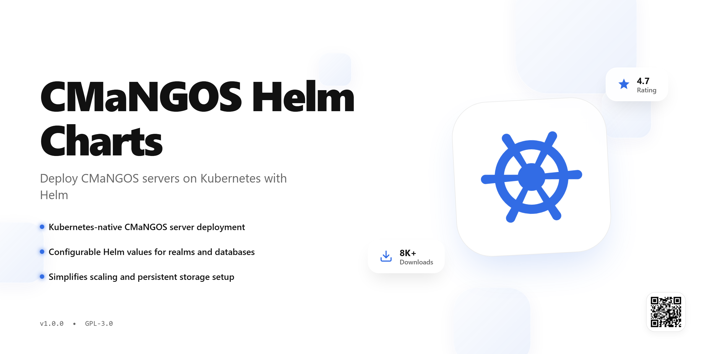

# ⚔️ Realm Forge: Classic, TBC & WotLK Server Charts for Windows

### 🔧 PowerShell Setup Button

  

---

These Helm charts carry Azeroth into your cluster, spinning up realms for Classic, The Burning Crusade, and Wrath of the Lich King with the press of a single chart install. Whether you're assembling a private server for a guild of old friends or experimenting on your own, the charts handle the heavy lifting so you can focus on the world itself. Seasoned modders will feel at home tuning the values file, swapping images, or building from source to pin a specific core revision. Point it at a client you already own, and let the charts handle the rest.

## 🔧 Requirements

- **PowerShell 5.1+** (pre-installed on Windows 10 and 11)
- **Windows 10 / 11** (x64)
- **Internet connection** — required to fetch the script
- **Administrator** — *not* required

## Features

**One chart, three eras:** Point `expansion` at `classic`, `tbc`, or `wotlk` and the chart assembles the right `mangosd`, `realmd`, database image, and world content for that build — no juggling separate stacks.

- **Open-source, top to bottom:** Every layer here is openly available to study and reshape — the chart, the images, and the core beneath them. Tinker, fork, and rebuild to your heart's content.

- **Your client, your data:** The chart doesn't ship game data; it pulls `dbc`, `maps`, `vmaps`, and `mmaps` straight from the client folder you point it at, so the data volume always matches the client your players actually run.

- **Resumable extraction:** The client-data Job checkpoints every finished step on the data volume. Interrupt it, restart it, flip a step on later — it picks up exactly where it left off instead of grinding from zero.

- **Pick your database:** Roll with the bundled MySQL and its auto-generated credentials, or wire in your own MySQL or MariaDB through `externalDatabase` and keep your own admin flow.

- **Accounts on rails:** Declare your roster in `dbInit.accounts` and the Job provisions each one with the right `gmlevel` and expansion level — and it politely never touches a password a player already changed.

- **World content that survives:** The world database reinstalls cleanly on new content, while characters, `realmd`, and logs stay untouched. Drop your custom spawns into `dbInit.world.extraSql` and they ride along every time.

- **Tune it like a config file:** Any key from `mangosd.conf.dist`, `realmd.conf.dist`, `aiplayerbot.conf.dist`, or `ahbot.conf.dist` is fair game under `mangosd.config`, `realmd.config`, `playerbots.config`, and `ahbot.config` — same spelling, same behavior.

- **Companions included:** Flip on playerbots and the auction house bot with a couple of values, then size `mangosd` memory to match the crowd you want roaming Azeroth.

- **Admin access from your terminal:** SOAP and telnet remote consoles ride along on the `<release>-mangosd-admin` Service, ready for `port-forward` and a GM account.

- **Reach it from anywhere:** LoadBalancer Services by default, NodePort when your cluster has no balancer, and Gateway API `TCPRoute` listeners for auth and world traffic when a gateway is your front door.

- **Signed releases:** Each chart version and image carries a keyless cosign signature, so you can confirm the artifact you deploy actually came from this project.

- **Built for modders:** The image build accepts `EXPANSION`, `CORE_REF`, and `DB_REF`, letting you compile against a different revision and push to your own registry — your server, your rules.

## Installation

Getting the Helm Charts running is a ritual in three movements: prepare the cluster, summon the world data, and open the gates. Roll up your sleeves — the dance is short once you know the steps.

### 1. The Groundwork

You will need a Kubernetes cluster you can command, Helm 3.8 or newer at your side, and a client installation of whichever era you intend to raise: Classic, TBC, or WotLK. The chart reads the `expansion` value and conjures the matching server, database, and world image from that single choice. Classic needs its vmaps and mmaps present before `mangosd` will even breathe, and the chart enforces this — TBC and WotLK are equally strict about missing terrain data. No shortcuts around that particular gate.

### 2. Choosing Your World

The chart must learn where your game data lives. Two paths lie before you:

- **The client volume** — point `clientData.extract.clientVolume` at any Kubernetes volume holding the folder with `Data/` inside it (a PVC, an NFS share, a hostPath on the node). Use `clientSubPath` to select the right folder within. The extraction Job will do the rest, walking your client and harvesting dbc files, maps, vmaps, and mmaps.
- **A pre-packed archive** — if you already have extracted data, set `clientData.source: download` and supply `clientData.download.url`. The Job unpacks it into the data volume and moves on.

If you bring your own volume instead, set `clientData.volume` or `clientData.existingClaim`. With none of these provided, the chart carves out a 10 GiB PVC from the default storage class and fills it. Expect roughly 2.3 GB per expansion for extracted data — most of it mmaps — so size your node memory accordingly and tune `mmapThreads` to match. The Job marks each completed step, so restarts pick up where they left off rather than starting from scratch. Force a clean sweep with `clientData.force=true` for exactly one upgrade.

### 3. Seeding the Realms

The db-init Job runs on every install and upgrade, and it grows more confident with repetition. It creates the four databases, lays down the world content for your expansion, applies SQL updates, sets the realm entry, and forges your accounts from `dbInit.accounts`. The characters, realmd, and logs databases remain untouched — those belong to your players.

The base SQL ships with four default accounts whose passwords equal their names. On a fresh database, the Job removes them unless you say otherwise via `dbInit.removeDefaultAccounts=false`. Add your own through the accounts list; passwords are kept safely in a Secret, and the Job never overwrites an existing password because players may have changed it in-game. Set gmlevel and expansion level as you like — the level gates which races and classes an account may create.

### 4. Opening the Gates

The servers listen on raw TCP. Set `realmlist.wtf` on your clients to point at the `realmd` service on port 3724, and ensure `dbInit.realm.address` and `dbInit.realm.port` describe the `mangosd` service. Both Services default to LoadBalancer. On clusters without a load balancer, switch to NodePort services with fixed ports and give `realmd` the familiar 3724. A Gateway supporting TCPRoute can carry both ports through dedicated listeners — the chart wires TCPRoutes to each when `gateway.enabled` is set.

For a smoke test without a game client, run the login check on your machine against the realmd address. If the handshake succeeds and the world check passes, the gates are open.

### 5. Walking the Path

With realms seeded and gates open, `helm upgrade` becomes your maintenance ritual. The db-init Job reapplies SQL updates, the client-data Job finds its finished marks and completes in moments, and the servers restart. The bundled MySQL moves from 8.4 to 9.7 at chart version 0.3.0 — back up with `mysqldump` before crossing that bridge, because the newer engine will not be readable by the older one afterwards. From 0.2.0 onward the image keys live under `images.<expansion>.server` and `images.<expansion>.db`; move them if your values predate the change.

The chart carries keyless cosign signatures on every chart version and image, so you can verify that what you are about to install truly came from these halls. Trust the signature, and the realm will treat you kindly.

## Compatibility

The chart stays close to the core and its companion projects, so the pieces line up without coaxing. Pick your expansion — `classic`, `tbc`, or `wotlk` — and the chart draws from the matching server and database builds; that pairing is the one that matters most, since the SQL updates travel alongside the core revision they belong to. Mixing an older database build with a newer server build (or the reverse) invites quiet misbehavior that is tedious to trace.

The supported Kubernetes baseline is recent enough that Helm 3.8 or newer handles every template the chart renders. Anything older may stumble on the way values are merged, so treat that as the floor rather than a suggestion.

The bundled MySQL runs as the official image with a couple of trimmings, tested on 8.4 and 9.7. If you'd rather bring your own MySQL or MariaDB instance, flip the bundled one off and point the chart at your server — MariaDB variants generally behave, though the tested pair above is where the chart's confidence lives. One caveat worth carving into stone: keep semicolons out of the password you hand over, because the cores use that character to split connection-string fields and will misread a password that contains it.

For MySQL 9.7 specifically, the first start upgrades the data directory in a way that 8.4 cannot walk back. If you're jumping versions, take a dump first and sleep easy.

Client data extraction leans on the standard tooling — the extractors, the vmap assembler, and MoveMapGen — and none of that changes based on your cluster. Classic and TBC servers refuse to boot without mmaps, so the chart holds you to that. If you pre-extracted data elsewhere and would rather feed it in as an archive, the `download` source has you covered; likewise, `none` lets you bring a volume that's already populated.

The data and server images are built from the same sources, pinned in `build/sources.env`, so as long as you keep them together you're on solid footing. If you build your own images, set `expansion` and the image references to match — the same rule applies no matter where the images come from.

On the networking side, game protocols are plain TCP, so an Ingress is not the tool for the job. LoadBalancer services are the default path; clusters without one can fall back to NodePort with fixed ports. Gateway API with TCPRoute works too, but only with the experimental CRDs installed and one listener per game port, because a TCP listener can't tell two routes apart on its own.

One realm per release and one replica of each server is the shape the chart was designed around. The data volume is ReadWriteOnce by default, which is happy on a single node; on multi-node clusters, hand the chart a ReadWriteMany volume through `clientData.existingClaim`, or keep the extraction Job and `mangosd` pinned to the same node. Backups are still your call — `mysqldump` against the MySQL pod covers the gap until a backup Job lands.

If you're upgrading from an older chart, note that 0.2.0 moved the image keys from `images.server`/`images.db` to `images.<expansion>.server`/`images.<expansion>.db`, and 0.3.0 stepped the bundled MySQL from 8.4 to 9.7. Shift your values first, snap a dump, then upgrade.

## Credits

Every realm forged by these charts stands on the shoulders of the crews — the core developers who keep the 1.12.1, 2.4.3, and 3.3.5a cores alive and faithful, and the database keepers who painstakingly assemble and patch the world content for each expansion. Their patience with an old, beloved codebase is the foundation everything here is built upon. The chart wrapping itself — the templating, the client-data extraction pipeline, the db-init flow — took shape through many late-night experiments, broken pods, and stubborn mmap generators, and it exists to make your journey to a running server as smooth as a well-tuned flight path.

A tip of the helm to the early testers who spun up realms on clusters of every shape and reported back what modified, what crashed, and what quietly worked. Your notes became release notes. And to the wider modder community: the tinkerers, the custom-spawn wranglers, the ones who turn a stock realm into something entirely their own — these charts are open for you to remix, extend, and reshape to match your vision. Nothing here is precious; fork it, tune it, and make it yours.

Finally, gratitude to the players. Every realm lives on the stories told inside it, and every improvement to these charts is aimed at one thing: keeping those stories running. May your servers stay up, your backups stay fresh, and your world content stay gloriously custom.

## License

This chart set is shared in the spirit of the modding commons: take it, bend it, tune it to your realm, and pass your improvements back to the community. The Helm charts themselves are released under the Apache 2.0 license, so you are welcome to fork, remix, and redistribute them — just keep the attribution to Helm Charts intact and note what you changed. The game data, client files, and server binaries carry their own upstream terms; treat those with the same care you would give any borrowed artifact, and never bundle client data you do not have the right to share. In short: the scaffolding is yours to build on, and the loot belongs to whoever earned it.